# HAICoMo

> [0.5.0 预览版](https://github.com/jasonyao486/HAICoMo/releases/tag/v0.5.0)：Mac Apple Silicon 与 Windows x64 同步更新。凡是有命令行无界面模式的智能体都能在后台接活；接力最多三个阶段、每阶段三个任务并行，并可选无人值守模式；智能体检测结果在本次运行期间保留。见[发布说明](docs/RELEASE-NOTES-0.5.0.md)。

[English](README.md) · **简体中文**

一个管理项目、人工审阅与多 AI 智能体协作的本地桌面应用。智能体提交修改提案，由人类用户决定是否批准及何时通过交付验收。项目数据保存在选定的工作目录中。

当前双平台推荐预览版为 **0.5.0**。Mac 已签名、公证；Windows 仅当前用户安装。见[双平台验证记录](docs/TESTING-0.5.0.md)。历史版本与附件继续保留。

## 安装与开始使用

使用任务管理功能不需要安装 Node.js、Git，也不需要购买模型订阅。

1. 打开[下载与版本发布](https://github.com/jasonyao486/HAICoMo/releases)，两个平台均选择 **v0.5.0**，展开 **Assets**。
2. 按电脑类型下载。页面上的 “Source code” 是开发者源码，不是安装包。

| 电脑系统 | 下载文件 |
|---|---|
| 搭载 Apple M 系列芯片的 Mac | [HAICoMo-0.5.0-arm64.dmg](https://github.com/jasonyao486/HAICoMo/releases/download/v0.5.0/HAICoMo-0.5.0-arm64.dmg) |
| 系统类型为“基于 x64 的处理器”的 Windows PC | [HAICoMo-0.5.0-windows-x64-setup.exe](https://github.com/jasonyao486/HAICoMo/releases/download/v0.5.0/HAICoMo-0.5.0-windows-x64-setup.exe) |
| Intel Mac、Windows ARM64、Linux | 本版暂不提供已验证安装包 |

Mac 在“苹果菜单 → 关于本机”查看芯片；Windows 在“设置 → 系统 → 系统信息”查看系统类型。

3. **Mac：** 打开 DMG，将 HAICoMo 拖到 Applications（应用程序），推出磁盘映像，再从应用程序启动。正式包已通过 Developer ID 签名、Apple 公证并附加票据；首次启动可能出现普通“打开”确认，已完成的干净账户测试无需 Open Anyway。
4. **Windows：** 打开 setup `.exe`，自动安装到当前用户目录并启动；安装、升级和卸载不主动请求管理员权限。本版没有发布者签名，可能出现 SmartScreen 或未知发布者提示，这与管理员权限不同；确认来源并核对 SHA-256 后再决定继续。单位管理的电脑可能需要管理员协助。
5. 点击“新建项目”，选择一个空的本地文件夹，保存 `.haicomo` 入口文件。创建一个任务，再添加子任务。此过程不需要 AI 账号。
6. 交付后，从任务中打开交付物，检查内容，再点击“通过验收”。智能体运行完成不会自动通过人工验收。

<details>
<summary>如何核对下载文件的 SHA-256</summary>

从同一发布页下载对应的 `SHA256SUMS-darwin-arm64.txt` 或 `SHA256SUMS-win32-x64.txt`。保留安装包原文件名；如果文件位于“下载”文件夹，运行下面的对应命令，将结果与文本文件中该安装包那一行的完整校验值比较，大小写不影响结果。如不一致，请重新下载后再安装。

Mac：打开“终端”运行：

```sh
shasum -a 256 ~/Downloads/HAICoMo-0.5.0-arm64.dmg
```

Windows：打开 PowerShell 运行：

```powershell
Get-FileHash "$HOME\Downloads\HAICoMo-0.5.0-windows-x64-setup.exe" -Algorithm SHA256
```

校验值用于确认下载完整性，不等同于发布者签名。

</details>

需要 AI 协作时，自行安装并登录相应客户端，然后在“设置 → 本地智能体 → 检测”查看能力。共检测 15 个客户端，新增 Kimi、Grok Bot、DeepSeek Harness、Gemini CLI 与 Qwen Code；检测结果保留到退出应用，也可开启“打开 HAICoMo 时自动检测”，在后台检测一次。凡是有命令行无界面模式的客户端都能在后台接活：Codex、Claude Code、Cursor Agent、Kimi、DeepSeek Harness、CodeBuddy、Qoder CLI、Gemini CLI、Qwen Code、OpenCode、GitHub Copilot CLI 和 Pi。只有已安装版本的帮助文本列出所需参数时才会启用，并标注证据等级：Codex、Claude Code、Cursor 和 DeepSeek Harness（使用 DeepSeek 账号，无需 API key）已实测，Kimi 已在真实安装上核对参数，其余按官方文档适配。Grok Bot、WorkBuddy、TRAE 没有命令行，由 HAICoMo 打开应用并复制提示词。只有 Codex 的提问和审批能在 HAICoMo 内回答。Claude 无法在 HAICoMo 内批准交互写入权限，也不能可靠确认取消结束，详见 [Windows 功能验证](docs/TESTING-WINDOWS-2026-10-07.md)。每次启动任务前，HAICoMo 都会再确认程序仍在原处；若已不可用，会说明原因并拒绝启动，不会发出任务。HAICoMo 不提供订阅，也不会自动转用另行收费的 API。

自 0.4.0 起可在应用内更新：“设置 → HAICoMo → 检查更新”，点“立即更新”（显示进度、速度，可取消），准备好后再点“重启并安装”。自动检查只提示、不下载，可关闭。0.3.5 及更早版本需下载安装一次，或在其“更新源”中填入 `https://github.com/jasonyao486/HAICoMo/releases/download/v0.5.0`。在项目总览使用搜索（⌘F／Ctrl+F）可找回任务、修订、会议与备注。0.5.0 首次打开项目时，会先备份为 `pre-v6`，再迁移到 v6；0.4.1 及更早版本不能再打开已迁移的项目，所以共用项目的每台电脑都要更新到 0.5.0。需要回退时，将迁移前备份恢复到空目录。

完整手册：[简体中文](docs/USER-MANUAL-0.5.0.zh-CN.md) · [繁體中文](docs/USER-MANUAL-0.5.0.zh-TW.md) · [UK English](docs/USER-MANUAL-0.5.0.en-GB.md) · [US English](docs/USER-MANUAL-0.5.0.en-US.md)。

点击 logo 返回首页，不增加标签；原项目页面与草稿保留。收起侧栏后保留正常尺寸的文件夹与终端按钮。活动摘要使用简短角色，展开详情保留完整身份。

## 连接智能体

可从任务“交接”复制提示词，或向支持的客户端后台发送；也可在已有智能体会话中打开同一项目目录，再粘贴接入说明。

**0.3.5**在已打开项目顶部增加“连接智能体 → 复制接入说明”。不选任务时先读取并概述项目；选择任务后加入任务上下文及交付物引用。将说明粘贴到已打开同一项目目录的会话中。任务交接与接力也会在保留自定义内容的同时，自动加入接入指引。

智能体须具有该项目目录的本机访问权限。安装不会注册全局 `hcm` 命令、配置 MCP 或启动智能体。[使用手册：两种方式、可复制说明与完整演练](docs/USER-MANUAL-0.5.0.zh-CN.md#agent-onboarding)。

## 功能

以下图片展示空白首页，或独立的合成 “HAICoMo Demo” 项目（10 个任务、50 个子任务），不含真实工作内容或账号对话。双语 README 共用同一套英文界面截图；接力截图中的智能体都是不调用模型的测试替身。

### 首页与项目标签

点击 logo 返回首页，保留各项目的页面与草稿。收起侧栏后仍可使用文件夹与终端入口。

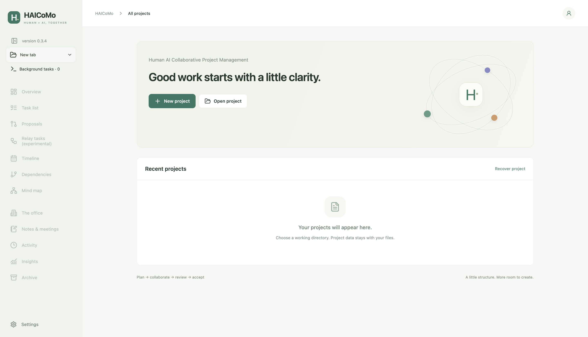

### 任务与子任务

分配模型或客户端，记录日期、交付物及前置关系。人工验收通过后，后续任务才能解除前置限制。

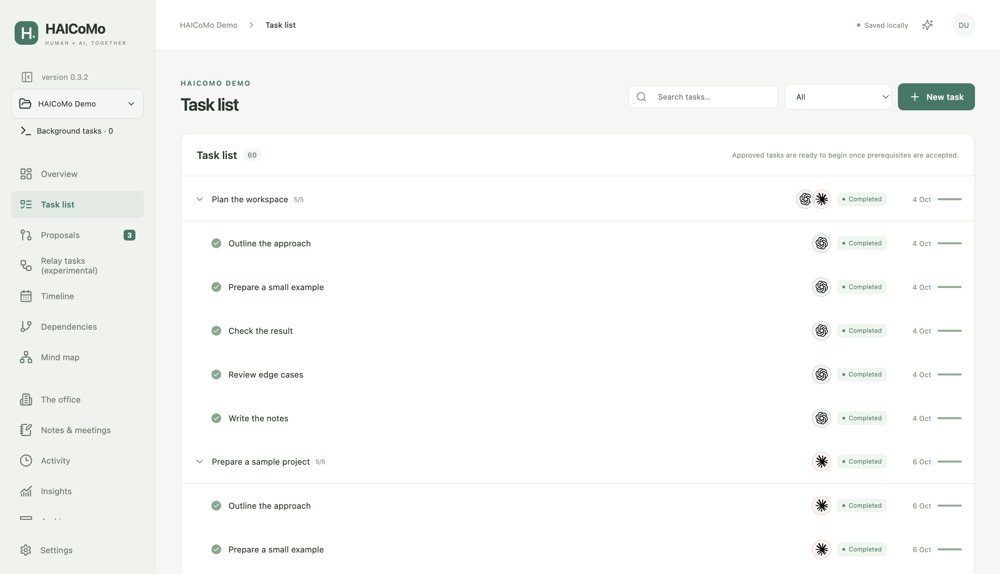

### 修订提案

审阅智能体提出的修改，可调整后批准，也可拒绝。修订号与事务检查避免旧修改覆盖新内容、避免只批准一部分。

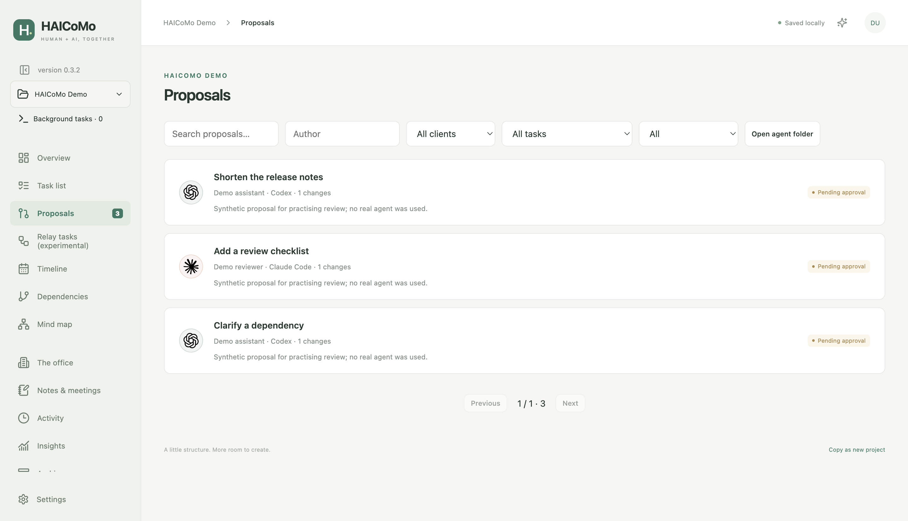

### 时间线、前置关系与思维导图

在时间线中安排任务日期，在关系图中检查前置条件或任务层级。图表支持缩放、适应画布和平移；明确指定模型的节点显示对应公司标志。

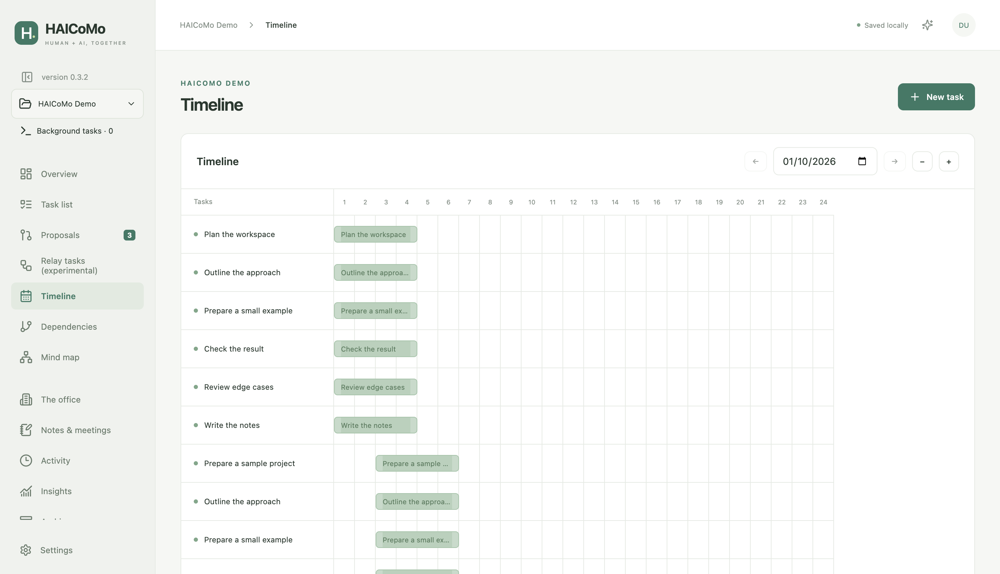

### 协作实验室

默认模式使用简洁人物；增强模式使用单独授权的拟人角色及手绘家具。动画展示可观测状态，不代表智能体一定正在工作，也不等于任务已完成。

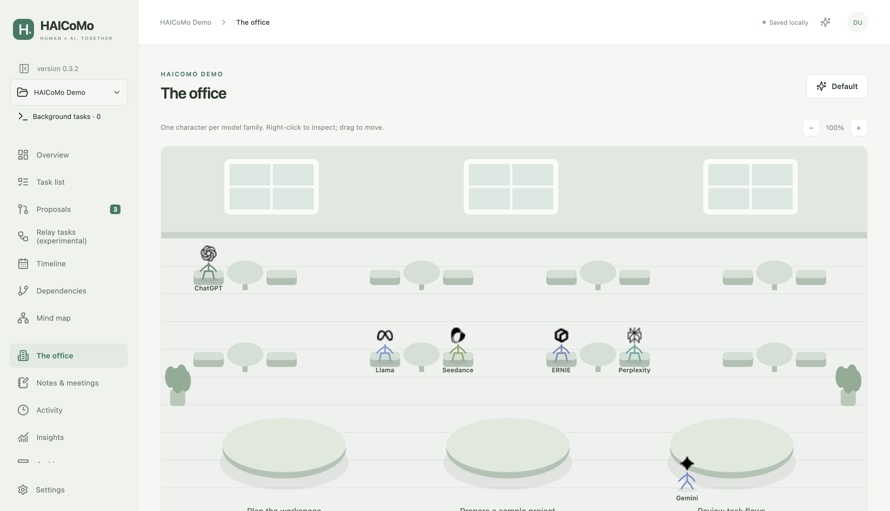

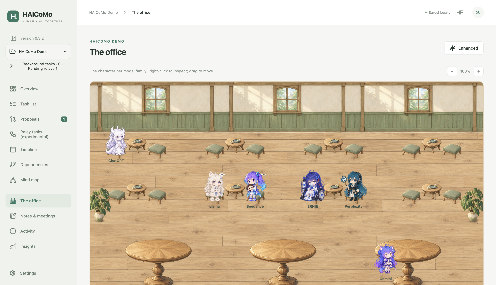

### 协作统计

查看任务参与、提案、交接及可观测运行时长。默认与增强模式使用同一份数据。

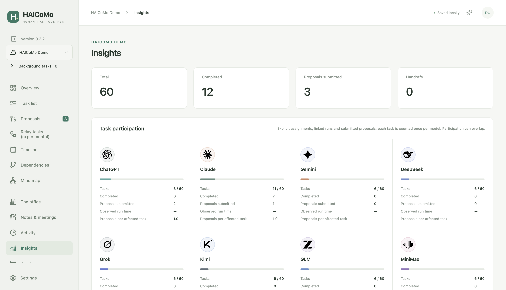

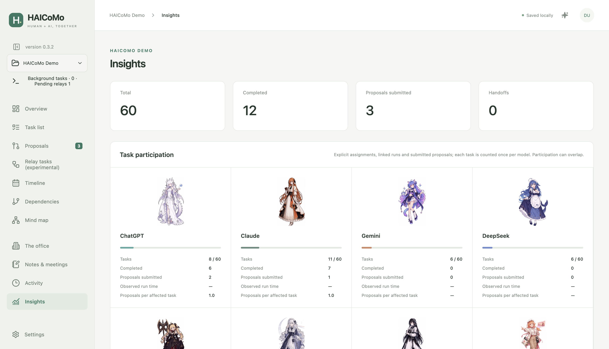

### 三阶段接力（实验）

接力在前置运行结束或到达设定时间后开始，最多经过 A → B → C 三个阶段，每个阶段最多三个智能体并行工作。当前阶段的任务全部交付后，下一阶段自动开始，提示词会带上前面阶段的结果，中间不需要审阅；每项交付仍由你验收。任一任务停止时，接力停在该阶段，等你重试或标记为已处理，HAICoMo 从不自动重试。接力要求应用运行且项目保持加载。

可视化模式中，工位只坐当前正在工作的阶段，每个等待中的阶段各坐一张三人沙发；文字模式以流程图显示同一个接力。

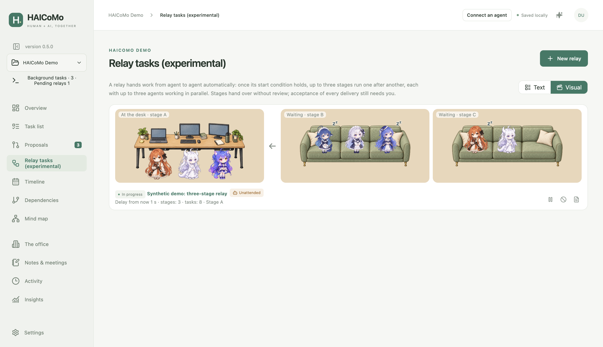

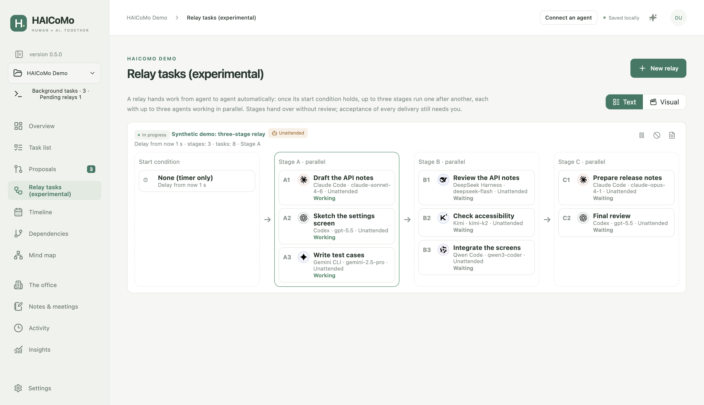

合成演示：Claude Code、Codex、Gemini CLI 在阶段 A 工作；DeepSeek Harness、Kimi、Qwen Code 等待阶段 B；Claude Code、Codex 等待阶段 C。所有智能体都是测试替身。

**无人值守模式**需按接力逐个同意。智能体使用各自的无人值守参数；HAICoMo 用推荐项回答 Codex 的选择题并批准其工具请求，但一律拒绝破坏性命令。登录、验证码、额度用完等只能由你处理的情况，会让接力暂停并发出通知。每个接力都有一份决策记录，列出代你做出的选择。

### 接力可视化预览

即使没有接力任务，可视化模式仍显示工位和三人沙发，默认与增强两种画风均可预览；空场景不放置智能体角色，也不会启动工作。

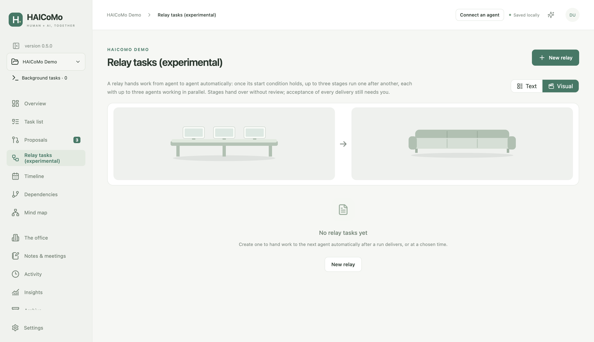

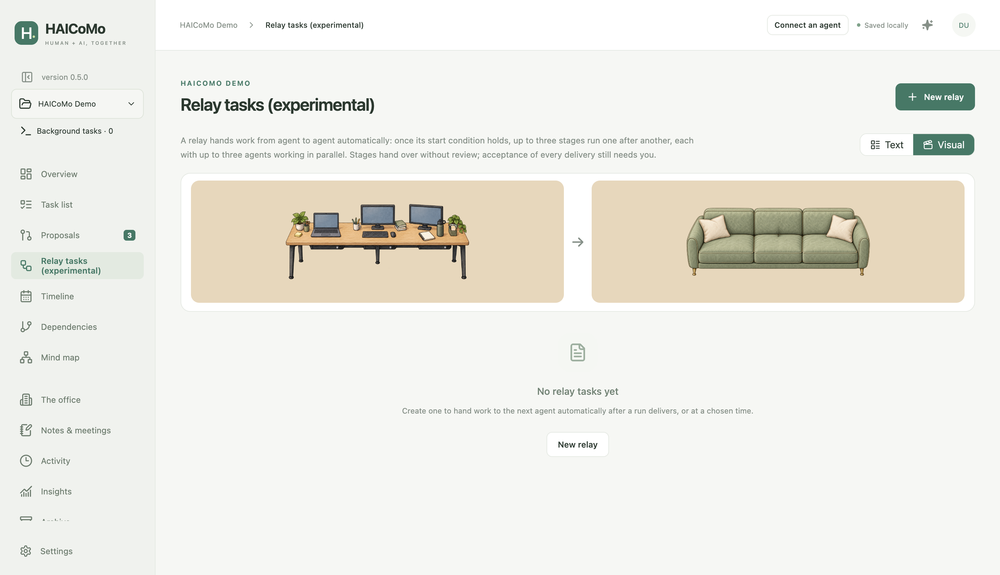

### 笔记、活动记录与恢复

笔记与会议记录跟随项目保存。活动记录可在确认后逐条永久删除，不撤销任务操作，也不改变历史返工统计。备份及独立副本用于恢复；备份 ZIP 只包含管理数据，不包含实际交付物文件。

`.haicomo` 入口与隐藏的 `.haicomo/` 数据目录必须一起保留。云盘或 Git 应采用本地编辑，停止运行及接力、退出应用、同步完成后再换电脑。活动 NAS 数据库与多机同时写入不受支持。不要把私人项目数据库或提示词提交到公开源码仓库。

## 协议与授权

源码及原创文档采用 [MIT](LICENSE)。角色素材按 ZipZipPipe 的**非商业使用及分发许可**提供；鲸鱼娘保留原作者署名链及 **CC BY-NC-SA 4.0**。环境家具采用 CC BY 4.0。公司标志仅用于识别，不表示背书。完整安装包并非所有内容都采用 MIT。

再分发前请阅读[素材许可](ASSET-LICENSES.md)、[逐文件来源清单](assets/manifest.json)和[第三方声明](THIRD-PARTY-NOTICES.md)。用户创建的内容仍归用户所有。

## 开发与反馈

安装 Node **24.21+** 与 npm 后：

```sh
git clone https://github.com/jasonyao486/HAICoMo.git
cd HAICoMo
npm ci
npm run dev
```

`npm test` 执行单元测试；`npm run test:e2e` 使用临时数据执行 Electron 测试；`npm run dist` 构建当前平台安装包，`npm run dist:win` 构建 Windows x64；`npm run demo -- /绝对路径/空目录` 生成演示项目。维护说明见[贡献指南](CONTRIBUTING.md)、[架构](docs/ARCHITECTURE.md)及[文件、CLI、MCP 协议](docs/PROTOCOL.md)。

[前往 GitHub 反馈](https://github.com/jasonyao486/HAICoMo/issues/new/choose)。附加诊断或截图前，请删除私人路径、提示词及凭据。当前证据见[0.5.0 验证记录](docs/TESTING-0.5.0.md)和[差距分析](docs/GAP-ANALYSIS.md)。
