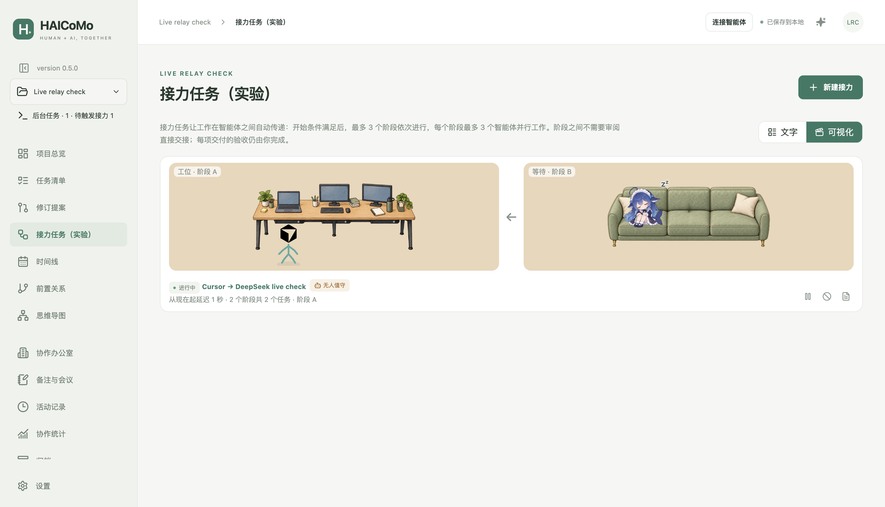
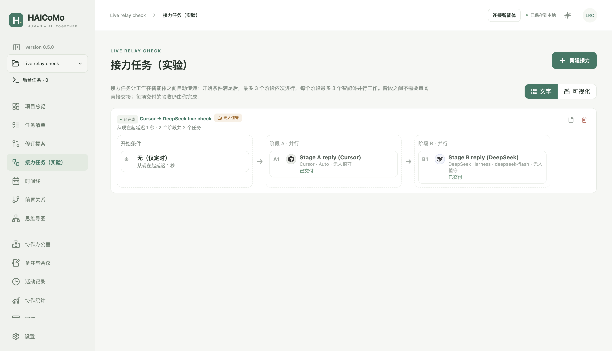

# 0.5.0 verification status

Status: **local macOS candidate, not published.** Implemented and verified on the development Mac (Apple Silicon) on 2026-10-15, revised on 2026-10-16 (round 2 below), on the local branch `dev/0.5.0`. Windows builds, native CI, notarisation and the fresh-account first-open check have not been run for 0.5.0; nothing here is claimed for Windows. Synthetic projects, fixture agents and isolated profiles only; no real Codex or Claude session was started.

## Changes

- **Agents.** Detection adds Kimi (`kimi-code`), Grok Bot (`grok-bot`), DeepSeek Harness (`deepseek-harness`), Gemini CLI (`gemini-cli`) and Qwen Code (`qwen-code`). Background launch moved to a data-driven adapter table (`src/providers/adapters.ts`) covering twelve clients; each is enabled only when the installed CLI's help names the flags it needs. See [AGENT_ADAPTERS](AGENT_ADAPTERS.md).
- **Relays (schema v6).** Up to 3 stages × 3 parallel tasks with automatic hand-over between stages; stopped tasks block their stage; retry / mark handled; interrupted claims never re-sent; v5 → v6 migration with backup.
- **Unattended mode.** Per-relay consent, clients' own autonomous flags, Codex questions answered with the recommended option, destructive commands declined, human-only steps pause with a notification, decision record.
- **Relay page.** Text view is a full flowchart; visual view seats the working stage at the desk and each waiting stage on its own three-seat sofa; desk and sofa have equal visible width. The enhanced three-seat sofa is a spliced placeholder (see [ART](ART.md)).

## Local macOS results (Apple Silicon, 2026-10-15)

| Check | Result |
|---|---|
| `npm run typecheck`, `npm run check:assets` | Passed; 86 runtime assets (sofa hash updated) |
| `npm test` (each file run separately) | 131/131 passed in 23 files, including new `adapters.test.ts` (8), `relay-stages.test.ts` (10) and updated relay/schema assertions |
| `npx playwright test` (source build) | 31 passed, 4 skipped (Windows-only, installed-upgrade and Windows in-app scenarios) |
| New `tests/e2e/v050.spec.ts` | Builds A1 + A2 → B1 in the editor with unattended consent; fixture Codex asks a question, HAICoMo answers "Safe (Recommended)" and records it; 3 `turn/start` calls, handoff stages 0/0/1, stage-B prompt contains A's results and the unattended instructions; decision record file written. Then a 3 × 3 relay: A1–A3 at the desk, B and C on two sofas (geometry inside each scene), cancelling one A run blocks the relay at stage A with Retry offered and no stage-B start |
| `prd_draft.md` SHA-256 | `da6a5edb…c41c8`, unchanged |
| Screenshots inspected | Relay text flowchart (completed and 3 × 3), visual default and enhanced (1, 2 sofas; blocked), editor flow and unattended consent, decision record; demo relay in light and dark |

## Live checks of locally installed CLIs (no task executed successfully)

Run once each in a temporary directory with a "reply with one word, use no tools" prompt.

| CLI | What was verified | Why the success path is unverified |
|---|---|---|
| Kimi Code CLI 2.2.0 (`~/.kimi-code/bin/kimi`) | Flags (`--prompt`, `--output-format stream-json`, `--yolo`, `--auto`, `--session`, `--model`); first stream line `{"role":"meta","type":"system.version"}`; exit 1 with the error on stderr | The account's monthly quota is exhausted (provider 403) |
| DeepSeek Harness 0.2.0-rc.2 (bundled `dsh`) | `--profile headless --json -` events: `session` (sessionId), `status` phases, `turn_end` with `reason.kind=error`, `final`; exit 1; permission presets via `DSH_PERMISSION_MODE` | Headless needs a DeepSeek API key (`MISSING_CREDENTIAL`); none is configured, and HAICoMo does not obtain keys |
| Cursor Agent 2026.01.23 | Flags (`-p`, `--output-format stream-json`, `--force`, `--approve-mcps`, `--workspace`, `--resume`, `--model`); logged-out error path (exit 1, "Authentication required") | Not logged in on this Mac |
| Grok Bot 0.70.2 | App bundle detected; no command-line interface found | Manual handoff only by design |

Gemini CLI, Qwen Code, CodeBuddy, Qoder CLI, OpenCode, GitHub Copilot CLI and Pi are not installed here; their adapters follow vendor documentation and the help-text gate and are exercised only with fixtures.

## Local candidate installation (2026-10-15)

| Step | Result |
|---|---|
| Build | `electron-builder` with the same options as `scripts/release-mac.mjs prepare` (arm64 `dir`, hardened runtime), signed with the login keychain's Developer ID Application identity (team `CXWHS9FG9S`, the same team as official releases), **not notarised** |
| Checks on the candidate | `codesign --verify --deep --strict` passed; authority chain Developer ID → Apple Root CA; `check-package.mjs` passed; packaged-app e2e: 16/16 on the first candidate (v050, v030, readme-relay, tabs, v031, updates, update-safety, v041) and 8/8 on the final candidate after a one-line label fix (v050, v030, tabs, v031) |
| Install | `npm run install:local:mac`: `/Applications/HAICoMo.app` is 0.5.0 (bundle digest `50b471c9…`), strict signature valid, exactly one registration. The replaced 0.4.1 is kept as `release/archives/app.haicomo.desktop-0.4.1-b588247baec7fadc.zip` |
| Launch | Installed app launched with isolated synthetic profiles: directly (demo project, relay visual/text views, agent detection) and through LaunchServices (`open -a`), which ran without a Gatekeeper prompt and quit cleanly. `spctl` reports "Unnotarized Developer ID", as expected for a local build that was never quarantined |
| Agent detection from the installed app | Background: Codex, Claude Code, Cursor, Kimi, DeepSeek Harness. Manual only: WorkBuddy, Grok Bot. Not installed: Pi, Copilot, OpenCode, TRAE, Qoder, CodeBuddy, Gemini CLI, Qwen Code |

Because the candidate is signed by the same Developer ID team, later official releases (0.5.1 and newer) can replace it through the in-app updater. An official 0.5.0 has the same version number and will not be offered as an update; after 0.5.0 is published, replace the candidate with the published artifact (`install:local:mac` from the release ZIP) if an identical-to-release copy is wanted.

## Round 2 (2026-10-16): review fixes and live runs

Changes after the user's review:
- **Relay scenes fill the row and centre the furniture.** Each scene grows to share the row's width, so there is no blank strip on the right. Each drawing's visible part is centred vertically, leaving the band below the desk for working agents to walk in; seated agents move up with the cushions.
- **Settings → Local agents is one table.** Detection results (status, version, background ability, evidence, reason) fill the middle of each client's row, and the detected path appears under its path field. The duplicate list below is gone. Detect and Save share one aligned row with a 12 px gap.
- **The relay editor is wider.** It is up to 1280 px wide (96 % of the window), so stages A, B and C stay side by side; a narrow window scrolls the flow sideways instead of wrapping.
- **DeepSeek Harness runs on the account route.** Each run gets a private `--patch` overlay with the desktop app's provider (`deepseek-account`) and the step's model, or the desktop app's current default when the model is empty. Unsafe model ids are refused. The overlay is deleted when the run ends.

| Check | Result |
|---|---|
| `npm test` (each file) | 132/132 in 23 files (adapter tests: hermetic `DSH_HOME`, typed model, desktop default, no overlay, unsafe id) |
| `npx playwright test` (source build) | 31 passed, 4 skipped |
| New e2e assertions (`v050.spec.ts`) | Three editor stages share one row; scenes reach the strip's right edge; 15 merged client rows with detection status and no separate list; Detect/Save aligned with ≥ 10 px gap; name, detection result and reset columns never overlap |
| Packaged candidate (Developer ID, not notarised) | `check-package.mjs` passed; 17/17 packaged-app scenarios (v050, v030, readme-relay, tabs, v031, v040, updates, update-safety, v041); reinstalled, strict signature valid, exactly one registration |

### Live runs through HAICoMo (synthetic prompts, temporary directories, no files touched)

| Client | Result |
|---|---|
| Cursor Agent 2026.01.23 | After the user signed in (`cursor-agent login` in the browser), a run through HAICoMo's runner completed in 18 s: reply `HAICOMO_OK`, model "Auto", session id recorded. No workspace-trust prompt in `-p` mode |
| DeepSeek Harness 0.2.0-rc.2, account route | `ds-v41-flash` was rejected by DeepSeek: "The supported API model names are deepseek-flash, deepseek-v4-pro". `deepseek-flash` completed in 4 s: reply `HAICOMO_OK`, DeepSeek family avatar, session id recorded. No API key involved |
| **Cross-agent relay in the installed app** | Unattended two-stage relay: A1 Cursor → B1 DeepSeek (`deepseek-flash`), isolated profile, synthetic project. Completed in 76 s. Stage B started automatically after A delivered; B's prompt contained A's token (`RELAY-A-OK`) and B quoted it. Both agents listed their decisions in the `HAICOMO-DECISIONS` block. The decision record was written to `.haicomo/relay-decisions/`; no files were created in the project |

Still unverified live: Kimi (quota exhausted until the next cycle), the seven documented-only adapters (not installed), and everything on Windows.

