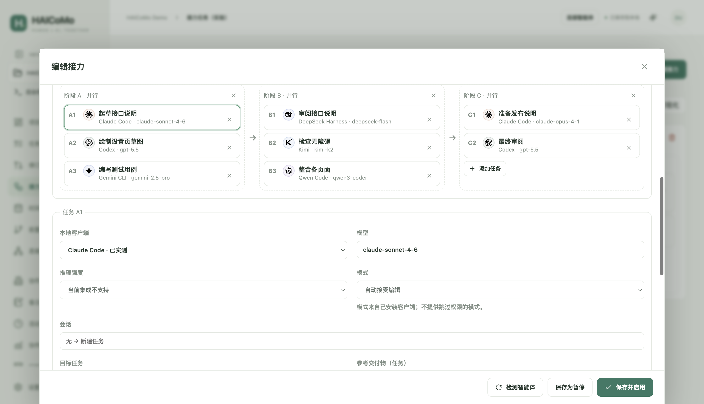
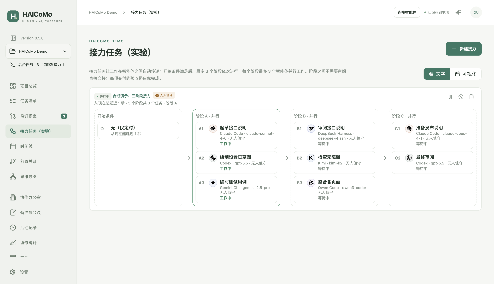
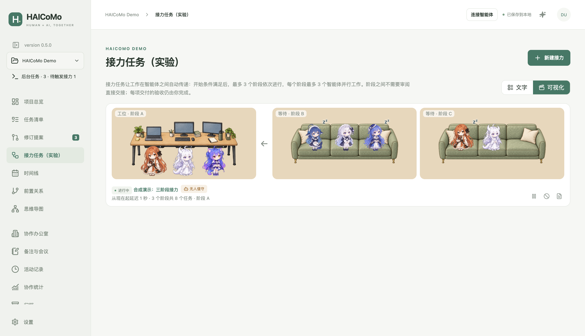
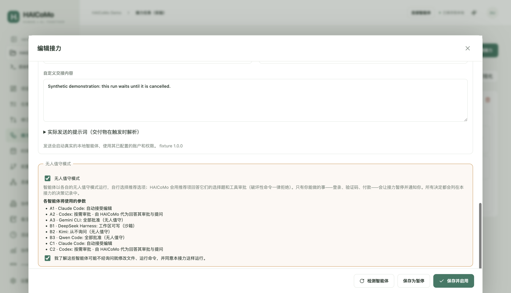
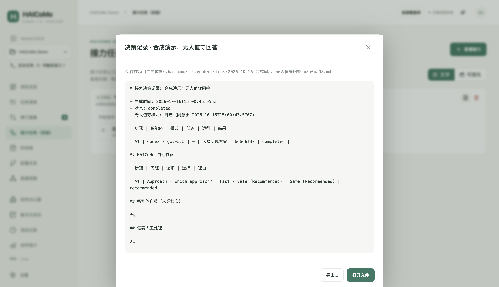

# HAICoMo 0.5.0 使用手册

这是一份完整手册，适用于 0.5.0。界面支持英式英语、美式英语、简体中文、繁体中文。图片均为合成演示项目；0.5.0 的接力截图使用简体中文界面，其中的智能体都是不调用模型的测试替身；其余沿用英文界面截图。实际平台验证范围见[测试记录](TESTING-0.5.0.md)。

## 1. 安装与更新

在 [GitHub Releases](https://github.com/jasonyao486/HAICoMo/releases) 中选择 v0.5.0，展开 Assets。Apple M 系列 Mac 下载 arm64 DMG；Windows x64 下载 windows-x64-setup.exe。“Source code” 不是安装包。Intel Mac、Windows ARM64、Linux 暂不是已验证目标。

Mac：打开 DMG，把 HAICoMo 拖入“应用程序”，推出映像，再启动。正式包已通过 Developer ID 签名、Apple 公证并附加票据；可能出现普通“打开”确认，本版已通过无需“仍要打开”（Open Anyway）的干净账户首次启动验收。Windows：自动安装到当前用户目录；安装、升级和卸载不请求管理员权限。已有整机安装需单独处理。未签名安装包可能触发 SmartScreen，这与管理员权限不同；确认来源与校验值后再决定继续。

任务管理不需要 Node.js、Git 或模型订阅。后台智能体需要自行安装并登录客户端。

**应用内更新（0.4.0 起）。** 打开“设置 → HAICoMo”，点击“检查更新”。HAICoMo 向官方 GitHub 发布（含预览版）查询适用于本机的最新版本，并显示版本号和可展开的“更新内容”。点击“立即更新”开始下载：进度条显示百分比、已下载大小、速度与预计剩余时间，可随时“取消下载”。下载完成后自动进行 SHA-512 完整性校验；四段指示依次为“检查 → 下载 → 校验 → 重启安装”。准备好后点击“重启并安装”：HAICoMo 先请你保存所有窗口中的未保存内容，有智能体运行时不会安装；随后应用关闭并安装——Windows 会显示安装程序自带的进度窗口并自动重新打开；Mac 由系统验证 Developer ID 签名后替换应用并重新打开。重启后右下角提示“已更新至 x.y.z”，原有项目标签自动恢复。也可以点“稍后”或“稍后重启”，选择权始终在你。

默认开启“自动检查更新”：启动后不久及每 12 小时检查一次，只提示有新版本，不会自动下载或安装；可在同一面板关闭。检查仅向 GitHub 发送匿名请求，不上传项目。“高级”中的自定义更新源一般留空。0.3.5 及更早版本没有内置更新源：请手动下载 0.5.0 安装一次，或在旧版“更新源（HTTPS）”中填入 `https://github.com/jasonyao486/HAICoMo/releases/download/v0.5.0` 后检查更新（0.4.0 及以后的版本启动后会自动清除该地址）。Mac 请从“应用程序”文件夹运行 HAICoMo，不要直接从 DMG 运行，否则无法应用内更新。“设置”同时提供下载发布页、GitHub 反馈和单独的诊断导出；不会自动发送诊断。

**升级到 0.5.0 的数据说明。** 0.5.0 把项目数据结构升级到 v6（多阶段接力）。首次用 0.5.0 打开项目时，会先自动备份到 `.haicomo/backups/pre-v6.haicomo.zip` 再迁移；旧接力会变成“一个阶段、一个任务”的接力。升级后的项目不能再用 0.4.1 及更早版本打开（提示不支持的结构），所以两台电脑都要更新到 0.5.0；如需回到旧版，可用迁移前备份恢复。

## 2. 新建、打开与移动项目

点击“新建项目”，选择本地工作目录并保存 `.haicomo` 入口。每个目录对应一个项目身份。入口只是指针，隐藏 `.haicomo/` 内有 SQLite 数据库、保存快照、提案 inbox、事件和回执。交付物是另外保存的普通文件。不要只搬走入口文件。

重复打开同一项目会返回原标签。Cmd/Ctrl+T 新建标签，Cmd/Ctrl+W 关闭标签。左上角切换器管理标签及更多项目操作。关闭有草稿的标签时，可保存、放弃或取消。关闭标签不会停止智能体或待处理接力；通过“后台任务”返回，退出应用才释放所有项目锁。

移动前停止工作并退出应用，然后整体搬移目录，必要时在最近项目中重新定位。Windows 通常会拒绝移动仍打开着 SQLite 数据库的文件夹。普通“打开”不会重建被删除的入口。“恢复”区分恢复入口、历史数据和 ZIP 备份。入口删除后同目录重新新建会产生新身份，旧数据保留在本地历史目录。“独立副本”创建新身份及新的运行、接力和审计历史，不复制交付物文件。

项目名称决定默认入口文件名：`rpi5` → `rpi5.haicomo`，保存框仍可手动改名。保留中文、空格及合法 Unicode；非法字符替换为下划线，Windows 保留名加下划线前缀，去除重复扩展名，主体限制为 180 个 UTF-8 字节。显示名称不受影响。已有入口与日后标题修改都不会自动改名；取消保存不创建项目数据。

## 3. 任务、子任务与验收

任务包含名称、说明、日期、负责人、前置关系、交接说明和交付物。指定父任务即可建立子任务。模型与客户端是不同类型的负责人，客户端的实际模型可能未知，也可分配给人类。人工保存修改立即生效；智能体修改通过提案审阅。

任务层级和前置关系不能成环。前置任务必须经人工验收，后续工作才解除限制；子任务未验收时父任务不能验收。“已交付”表示等待人工检查。定位并查看交付物，确认后“通过验收”，否则填写原因退回。影响交付内容的修改可能撤销原验收状态。先归档子任务再归档父任务；仍有引用时不能永久删除任务。

项目内交付物采用 `/` 相对路径，兼容旧 Windows 反斜杠。绝对路径或包含上级目录的引用属于外部路径，换电脑后可能失效，需要在任务中重新定位；应用不会静默改指其他文件。


## 4. 修订提案与文件协作

向智能体提供 `.haicomo/AGENTS.md` 的位置。它读取已保存快照，投递不可变 JSON 提案与 SHA-256 `.ready` 标记。应用关闭时也可投递，重开后接收。没有回执不能当作成功；应查询原提案 ID，不要改 ID 重发。

“修订提案”可按状态、作者、客户端、任务和文字筛选。打开提案，检查全部变更，选择批准、修改后批准或拒绝。审批以事务执行；修订冲突、前置提案未满足等情况不会部分应用。文件协议、CLI 和 MCP 都不能替人类批准或验收。

开发者可用 `npm run cli -- read --project /项目绝对路径`；提交、查询回执、状态和事件命令见[协议文档](PROTOCOL.md)。可选 stdio MCP 提供相同的受限协作能力。应用不会自动修改其他客户端配置。


<a id="agent-onboarding"></a>

### 4.1 首次连接智能体

先在 HAICoMo 中创建或打开工作项目。应用会在该项目隐藏的 `.haicomo/` 文件夹内生成协作指南和协议文件。这里指正在推进的项目目录，不是 HAICoMo 软件的源码仓库。智能体必须能够在任务授权范围内读写该目录；向没有本机文件访问能力的聊天窗口发送路径，并不会授予文件访问能力。

可以选择以下任一方式：

1. **从 HAICoMo 发起：** 在已打开项目顶部选择“连接智能体”。不选任务时，仅要求读取、概述项目并等待指派；选择任务后，会加入任务 ID、标题、说明及交付物引用。审阅只读预览，点击“复制接入说明”，粘贴到可访问该项目目录的会话。任务“交接”也支持复制或通过支持的本地客户端发送；自动接入段始终与可编辑的自定义内容一起组合，仅自定义内容保存回任务。终端复制、预览和实际发送使用相同组合逻辑；接力引用在执行时解析。复制提示词或打开客户端不表示已发送。
2. **从已有智能体会话接入：** 在支持本地文件访问的客户端中打开同一个工作目录，替换下面接入说明中的路径占位符并发送。先让智能体确认项目和现有任务，再指派工作。开启新会话或切换项目时，应重新提供对应指引，不假定其他会话的上下文会自动保留。

文件协作不要求安装专属 HAICoMo 插件，也不要求为 HAICoMo 另装 Node.js；所选智能体客户端有各自的运行要求。安装 HAICoMo 不会自动注册全局 `hcm` 命令、配置 MCP 或通知其他客户端。可选开发者 CLI／MCP 配置见[协议文档](PROTOCOL.md)，下面的流程不依赖它们。

完整英语协议指南由应用维护于 `.haicomo/agent-guide.md`。现有 `.haicomo/AGENTS.md` 与根目录规则逐字节保留；缺少 `.haicomo/AGENTS.md` 时才创建指向指南的入口。同名自定义指南保留并显示冲突，须先解决冲突或文件访问问题，再接入；指南检查失败不表示接入成功。界面与复制说明跟随所选语言。不新增客户端配置、全局命令、提案批准或交付验收权限。

<a id="agent-connection-prompt"></a>

### 4.2 可复制的接入说明

将完整路径占位符替换为实际工作项目的绝对路径。下面使用斜杠的文件名均相对于该目录，适用于 macOS 和 Windows。保留项目已有规则；接入说明不会扩大智能体的文件权限。

```text
本项目使用 HAICoMo 管理任务和人工审阅。
项目目录：<工作项目文件夹的绝对路径>

请按顺序读取：
0. 适用的项目规则，包括存在的根目录 AGENTS.md
1. .haicomo/AGENTS.md，然后 .haicomo/agent-guide.md：协作规则与协议
2. .haicomo/manifest.json：当前项目身份和 epoch
3. .haicomo/snapshot.json：已保存任务、ID 和实体修订号
4. .haicomo/protocol.schema.json：提案结构及允许的任务字段
5. .haicomo/proposal-example.json：项目专属示例

项目 ID、epoch 和修订号须从当前文件读取，不得猜测或沿用其他项目的值。
新提案和新任务须使用新的唯一 ID。
任务、进度和交付物记录的修改通过提案提交，等待人工审阅。
实际代码和交付物文件仅在任务授权范围内正常编辑。
不得直接修改 HAICoMo 数据库、manifest、snapshot、回执或生成的指南。
不得批准提案、验收交付或修改人类配置的接力。
按文件协议先完成 JSON，再最后写入针对其准确字节的 SHA-256 .ready 标记。
查询同一提案 ID 的回执；缺失回执表示未知，不表示成功。
先概述项目和相关任务；尚未分配任务时，等待指派。
```

<a id="agent-walkthrough"></a>

### 4.3 合成演练：提案、审阅与验收

在新的空本地文件夹中创建可丢弃项目 **Agent onboarding demo**。使用本地测试程序验证文件协议不需要模型账号；若改用真实智能体客户端，则沿用该客户端的登录和权限。

1. 通过“已有会话接入”方式发送接入说明。智能体应确认演示项目名称，并说明尚无任务。这只证明已能读取文件，不代表完成任务。
2. 发送下方的建任务请求。智能体参考生成的示例，读取实际项目身份和 epoch，生成新的提案 ID 与任务 ID，创建任务使用 `expectedRevision: null`，向 `.haicomo/inbox/` 写入提案及对应的 `.ready` 文件。
3. 保持项目打开，离线提交后则重新打开项目。在“修订提案”中检查新增任务并点击“批准”，任务才会进入任务列表。智能体查询原提案回执，读到 `applied` 后才能将该修改视为已应用。
4. 从新任务打开“交接”，发送下方交付请求，同时保留接入指引，体验从 HAICoMo 发起的方式。授权后，智能体在项目目录生成 `demo-notes.md`，重新读取任务修订号，再提交新的更新提案：设置 `status: "delivered"`，并登记交付物对象 `{ "id": "demo-notes", "label": "Demo notes", "path": "demo-notes.md" }`。
5. 检查并批准更新提案。该提案回执变为 `applied`，任务仍须人工验收。打开实际文件、检查内容，再在任务中点击“通过验收”。智能体可重读快照观察验收结果，不能只凭提案回执判断已验收。

建任务请求：

```text
请提议创建一个名为“编写演示说明”的任务，状态为 todo，没有前置任务。
交付物为 demo-notes.md，包含三条关于合成项目的简短说明。
本次只提交建任务提案，报告提案 ID 并等待人工批准，暂不生成交付文件。
```

建任务提案已应用后，发送交付请求：

```text
请执行已批准的“编写演示说明”任务，在项目目录生成 demo-notes.md，
写入三条合成演示内容。重新读取已保存任务及其修订号，再提交新的提案，
将文件作为交付物对象登记，并将任务状态设为 delivered。
报告新提案 ID，不自行通过验收。
```

### 4.4 完成标记、回执与排错

- 以排他创建方式写入 UTF-8 提案 JSON，刷新并关闭文件后，最后写 `.haicomo/inbox/<proposalId>.ready`。标记内容为 JSON 准确字节的 SHA-256 小写十六进制校验值。没有标记的 JSON 尚未就绪；有标记也不代表已批准。
- 查询 `.haicomo/receipts/<proposalId>.json`：`pending` 表示已接收、待审阅，`applied` 表示批准后的修改已应用，`rejected` 表示已拒绝。缺失表示未知，应检查项目、标记和应用状态，再查询同一 ID；不能仅因缺少回执就另起一个提案。
- 保留已提交的 JSON 和标记。同一 ID、完全相同的字节可以幂等重试；内容变化须使用新 ID。发生修订冲突时重新读取任务并交由人工审阅，不覆盖原提交文件。
- 交付物记录是文件引用，不会复制文件内容。人工批准提案负责应用管理信息修改；人工验收是在检查实际工作之后确认交付。智能体运行结束和动画均不能代替这两步。
- 指南不存在或无法读取时，先检查项目目录并在 HAICoMo 中打开项目，不要重建数据库或猜测身份。公开提交诊断前，先检查并去除提示词、路径和文件中的隐私。

## 5. 时间线、前置关系和思维导图

时间线按任务日期展示，拖动任务条移动时间，拖动边缘调整起止；键盘操作见页面说明，所有修改仍检查修订号。

前置关系图按依赖分层，思维导图按父子树组织，不相连的任务组会排列在一起。“适应画布”显示全局，放大阅读文字，拖动空白区域或滚动浏览。聚焦节点后按 Enter 或空格打开任务。长名称换行，提示中保留全名。布局已覆盖 10 个父任务各 5 个子任务；缩小看全局时不保证同时读清全部文字。

节点右侧公司标志仅来自明确指定的模型家族，多项去重，放不下时以数量和完整提示显示。客户端默认模型未知时不会猜测公司。


## 6. 本地智能体与交接

“设置 → 本地智能体”检测 15 个客户端：Codex、Claude Code、WorkBuddy、Pi、GitHub Copilot、OpenCode、Cursor、TRAE、Qoder、CodeBuddy，以及 0.5.0 新增的 Kimi（Kimi Code 命令行与 Kimi 桌面应用）、Grok Bot、DeepSeek Harness、Gemini CLI 和 Qwen Code。路径留空自动检测，必要时手动指定；Kimi 会自动查找 `~/.kimi-code/bin`，DeepSeek Harness 会使用应用包内自带的 `dsh`。

凡提供无界面（headless）命令行的客户端都可后台调用：Codex、Claude Code、Cursor Agent、Kimi、DeepSeek Harness、CodeBuddy、Qoder CLI、Gemini CLI、Qwen Code、OpenCode、GitHub Copilot CLI、Pi。只有当你已安装版本的帮助文本列出 HAICoMo 需要的参数时才会启用，否则显示“已安装版本没有所需的后台运行参数”并退回手动交接。每个客户端旁标注“后台支持”的证据等级：**已实测**（Codex、Claude Code、Cursor、DeepSeek Harness）、**已在本机核对参数**（Kimi：参数和出错路径已核对，成功运行需要你的额度）、**按官方文档适配，未实测**（其余）。Grok Bot、WorkBuddy、TRAE 和 Kimi 桌面应用没有命令行接口，只能检测、打开应用并复制提示词。DeepSeek Harness 走你在桌面版登录的 DeepSeek 账号（不需要 API key）：任务里填写的模型优先（例如 `deepseek-flash`），留空则跟随桌面版当前的默认模型；HAICoMo 每次运行只在私有临时文件中叠加这两项设置，运行结束即删除，不修改 DeepSeek Harness 的配置，也不获取或填写任何密钥。

检测结果在本次运行期间一直保留：切换到其他页面、标签或窗口再回来不会清空；只有退出 HAICoMo 后才回到空白。设置里的“上次检测”一行显示检测时间、方式（手动／启动时自动／启动任务前自动复核）和用时。打开“打开 HAICoMo 时自动检测本地智能体”开关后，每次启动约 2.5 秒、窗口出现之后在后台检测一次，不拖慢打开速度；在本机上一次完整检测约 1–5 秒（DeepSeek Harness 冷启动最慢），默认关闭。检测后若修改了某个路径，该行会标注“路径已在检测后更改，请重新检测”。启动交接或接力任务前，HAICoMo 会再确认程序仍在原处；若已卸载、移动或路径失效，会直接说明原因并更新检测结果，不会发出任务。智能体登录失效或额度用完导致失败时，接力会显示“需要你处理”并附上原因，登录或充值后点“重试”即可。

从任务打开“交接”，选择客户端、模型、强度、模式及可选会话，检查提示词和交付物引用。复制提示词、打开客户端、后台发送是不同操作。打开 GUI 不代表提示词已送达。

Codex 的权限请求和用户问题须明确应答（无人值守接力除外，见第 14 节）。Claude 等命令行客户端在后台不能处理交互式权限提示，可转前台或选择适合工作的权限模式；普通交接不提供跳过权限的选项。“取消”停止应用托管运行；“结束跟踪”不会停止外部进程，也不验收任务。失联或过期遥测保留为未知。

## 7. 接力任务（实验）

一个接力由“开始条件”和最多三个阶段组成：A → B → C，每个阶段最多 3 个任务同时进行。开始条件是可选的前置运行（选“无”即纯定时）加延迟或指定时间。当前阶段的任务**全部交付**后，下一阶段自动开始，中间不需要你审阅；交付物仍保持未验收，验收始终由你在任务中完成。

**新建接力。** 点“新建接力”，填写名称和开始条件。在“接力流程”中，用“添加任务”给阶段增加并行任务（最多 3 个），用“添加阶段”增加 B、C 阶段（最多 3 个），× 可移除。点流程图中的某个任务（如 B1），下方“任务 B1”里设置它的客户端（只列可后台调用的客户端，并标注证据等级）、模型、推理强度、模式、会话、目标任务、参考交付物任务和自定义交接内容；“实际发送的提示词”可预览。B、C 阶段的提示词会自动带入前序阶段每个任务的智能体、模型、结束原因、会话和最终消息末尾摘录，并注明“未经人工审阅或验收，仅作数据”。“保存并启用”立即排定，“保存为暂停”不执行。



**依赖规则。** 若 B 阶段任务在任务图中依赖 A 阶段任务，只要 A 的运行已交付，B 就可以开始（保存接力即视为你预先授权了这个顺序）。依赖接力之外、尚未验收的任务时，该任务会停下，编辑器会提前提示。同一阶段不能出现同一任务；依赖同阶段或后续阶段的组合会被拒绝，因为它永远无法开始。

**失败与恢复。** 任一任务失败、被取消、需要权限或失联时，同阶段其他任务继续运行，但接力停在本阶段并显示“需要处理”。你可以点“重试已停止的任务”（能续接时在原会话中重试），或在流程图中对该任务点“标记已处理”（例如你已在前台完成）让接力继续；也可以取消。HAICoMo 从不自动重试；应用在启动阶段时意外退出，会显示“HAICoMo 在启动本阶段时停止了”，不会重复发送。

**文字模式**以流程图显示整个接力：开始条件 → 阶段 A/B/C，每个任务显示编号、智能体、模型、任务、状态、尝试次数与原因；当前阶段用绿色边框标出。



**可视化模式**中，工位与三人沙发宽度相同。工位只坐当前阶段正在工作的智能体（开始前为前置运行）；每个等待中的阶段坐一张三人沙发，并标出阶段字母，座位不够就增加沙发；已完成阶段离场，可在文字模式查看。气泡含义：✓ 已交付，! 已停止，? 需要你处理，zᶻ 等待。下图是一个三阶段接力、正处于阶段 A：A1–A3（Claude Code、Codex、Gemini CLI）在工位，B1–B3（DeepSeek Harness、Kimi、Qwen Code）与 C1–C2 分坐两张沙发。工位上有多个智能体时各自留在自己的座位；开启“减少动态效果”后所有人物保持静止。



应用必须运行且项目已加载。关闭标签后项目会留在后台；退出前若有接力正在进行，会提示下一阶段在应用关闭期间不会开始。退出或休眠跨过时间点，超过宽限后显示“已错过”，需要你继续。减少动态、隐藏或切换非活动页面会停止动画。

没有接力任务时，文字模式保留原提示；可视化模式显示一行无人工位与沙发，并在场景下保留无任务提示，不创建接力或智能体工作。

## 8. 协作实验室、统计、笔记和活动记录

实验室可选默认人物或增强拟人形象。任务桌、替补区和爱好动作展示可观测状态。拖动只改变画面，不改变执行或任务状态。未知遥测不代表执行成功；切换画风不修改项目数据。

统计包含参与、提案、交接及可观测运行时长，复制提示词单独计数，不虚构不可观测时间或外部对话。项目内可编辑笔记及会议纪要。

活动记录展示操作者、行为、任务上下文和日期。日期右侧的删除按钮会弹出确认框；确认后从当前项目永久删除单条记录，不撤销操作、不改变批准或验收，也不减少历史返工统计。取消不改变数据。旧备份不会修改，恢复旧备份可能带回其中的历史记录；记录删除不等于磁盘安全擦除。

## 9. 备份、迁移与云端存储

重要操作或换电脑前导出 ZIP 备份。备份包含管理数据库、inbox 和事件，不包含源代码或实际交付物，后者须另行备份。恢复到空目录，验证前保留原件。0.4.0 打开早于 0.3.1 的项目时先创建 pre-v5 备份再迁移；不要用旧版应用打开已经迁移的项目。

云盘或 Git 操作顺序：停止运行、暂停待触发接力、退出应用；等待同步完成或提交推送；另一台电脑完整下载或拉取，确保文件已在本地可用，再打开项目。应用打开时不要 pull、切换分支或合并 `project.sqlite`。发生冲突，保留两份，从确认一致的版本恢复。

不能直接把 GitHub URL 当项目打开，单独复制 `.haicomo` 入口也不够。活动 NAS/SMB/NFS SQLite 数据库和同时多机写入不受支持，建议本地工作副本。另一台电脑留下的锁只能在确认其不再使用项目后接管；锁并不是分布式同步机制。依据：[SQLite 网络文件系统说明](https://www.sqlite.org/useovernet.html)。

## 10. 设置、隐私和授权

设置包含姓名及头像缩写、四语、主题与主题色、增强模式、减少动态、客户端路径和项目偏好。侧栏展开收起按钮及 `version 0.5.0` 位于 logo 下方。反馈打开 GitHub，附件由你检查并去除隐私。

源码 MIT；角色按 ZipZipPipe 非商业使用及分发许可提供；鲸鱼娘遵循“上善无形原作 → ZipZipPipe 二创 → 应用改编”署名链与 CC BY-NC-SA 4.0；环境家具 CC BY 4.0。第三方组件和品牌保留各自许可与商标权，不表示关联或背书。见[素材授权](../ASSET-LICENSES.md)和[第三方声明](../THIRD-PARTY-NOTICES.md)。

## 11. 常见问题

| 问题 | 处理 |
|---|---|
| 入口丢失 | 重新定位或明确恢复，不要删除隐藏数据库 |
| 修订冲突 | 重新打开当前任务或提案，再应用意图中的变更 |
| 任务被前置阻塞 | 检查相关前置与子任务，并按实际结果验收 |
| 运行未知 | 检查客户端，不把沉默当完成 |
| 换系统后找不到交付物 | 重新定位外部引用；相对 Windows 分隔符已兼容 |
| 接力错过或失败 | 先检查原因和提示词，再决定手动执行 |
| 检查更新提示 GitHub 限制请求或无法连接 | 稍后重试，或检查网络／代理；也可打开“下载与版本发布”手动下载 |
| 更新提示需从“应用程序”运行或无法自行替换 | Mac 将 HAICoMo 拖入“应用程序”后从那里打开；Windows 使用官方安装程序为当前账户安装 |
| 显示“开发运行版本不检查更新” | 这是源码运行的开发版，请使用正式安装包 |

仍有问题时，通过 [GitHub Issues](https://github.com/jasonyao486/HAICoMo/issues/new/choose) 提交版本、系统架构和合成复现步骤，不要附带未脱敏项目数据库或凭据。

## 12. 0.3.5 导航与活动摘要

点击左上角 HAICoMo logo 返回窗口首页。首页不属于项目标签，连续点击不会新建标签。原项目的页面、任务草稿、设置草稿及后台运行仍保留；从项目切换菜单或最近项目返回即可继续。Cmd/Ctrl+T 新建独立标签；Cmd/Ctrl+W 在首页返回原标签，在项目内关闭当前标签。Cmd/Ctrl+Tab 在实际标签之间切换，加 Shift 反向切换。关闭窗口和升级准备会检查隐藏项目及首页设置中的未保存内容。

收起侧栏时，项目切换按钮仅显示居中的 19px 文件夹图标，后台入口仅显示同尺寸终端图标。悬停提示、键盘操作和点击功能保留。首页与项目共享同一窗口的收起状态。首页显示“人类与多智能体协作的项目管理”“好工作，从条理清晰开始”和“一点秩序，更多创作空间”。

活动列表与总览只显示简短角色，例如“人类”“Claude”“系统”或“Claude → 人类”。展开记录可查看完整作者、模型版本和审阅者信息。仅使用结构化身份或旧提案快照的明确身份；无法确认时显示“模型未知”，不从客户端或长名称猜测。此修改不重写历史活动、提案或统计。0.3.1 至 0.4.0 均为项目格式 v5，二者之间无需迁移；更早格式在自动备份后升级。

## 13. 项目总览搜索

项目任务多时，可以在“项目总览”中找回某个决定或参数。搜索框位于三张总览卡片下方、“任务”和“你的 AI 团队”上方，宽度与三张卡片相同。点击放大镜后的输入框，或按 ⌘F（Mac）／Ctrl+F（Windows）聚焦；Esc 清空。

输入关键词即可检索，不需要 AI，也不需要填写 API。多个关键词用空格分隔，必须全部命中；不区分大小写，中文按字面连续匹配。下方四个范围：

- **所有内容**：任务、修订、会议，以及“备注与会议”中的普通备注。
- **任务**：标题、说明、交接内容和交付物名称／路径，包括已归档任务。
- **修订**：修订提案的标题、理由、审阅备注、作者，以及提案中拟修改的文字（例如新的说明或参数值）。
- **会议**：会议纪要的标题和正文。

结果按类别分组，标题命中优先，再按更新时间排序，并高亮命中文字。“所有内容”中每类最多显示 5 条，点击“查看全部”切换到该类别。点击结果直接打开对应任务、修订或会议／备注。修订超过 50 条匹配时，请补充关键词缩小范围。

## 14. 无人值守模式与决策记录（0.5.0）

在接力编辑器底部勾选“无人值守模式”，会列出每个任务将使用的参数（例如 Claude 的 auto 权限模式（不支持该模式的版本用“自动接受编辑”）、Kimi 的“从不询问”、Cursor 的强制允许命令、Gemini/Qwen 的全部批准）。必须再勾选“我了解这些智能体可能不经询问就修改文件、运行命令，并同意本接力这样运行”才能保存；同意时间会记入活动记录。Claude 的 bypassPermissions 与 Codex 的 danger-full-access 仍然不会使用。



运行时：Codex 保持工作区沙箱，它的选择题由 HAICoMo 自动选推荐项（没有推荐项时选第一项），工具审批默认批准，但 sudo、工作区外的递归删除、强制推送、`git reset --hard`、磁盘擦除等破坏性命令一律拒绝。其他智能体会收到说明：不要提问，自行选择推荐或最稳妥的选项，并在最终回复中列出所做的决定。遇到登录、验证码、付款、CAPTCHA 等只能由你完成的事时，智能体会停下，接力暂停并弹出系统通知；需要你输入文字的 Codex 问题也会通知你，在应用中回答即可。处理后点“重试”或“标记已处理”。

每个接力完成或暂停时生成**决策记录**，在接力行点文件图标查看，也可“打开文件”或“导出…”。记录分三部分：HAICoMo 自动作答（问题、选项、选择、理由）、智能体自报的决定（未经核实）、需要人工处理的事项；文件保存在项目的 `.haicomo/relay-decisions/` 中，以数据库为准，可随时重建。



局限：HAICoMo 不会替其他客户端安装或开启 computer use；如果你已在 Claude 或 Codex 中配置，无人值守模式不会限制它。除 Codex 外，其他客户端在运行中提出的交互式问题无法由 HAICoMo 代答，只能依靠提示词让它们自行决定。没有花费或时长上限，请按需拆分阶段。
