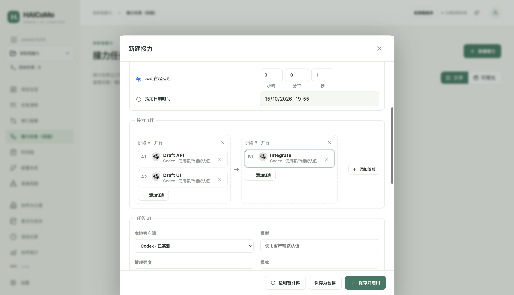
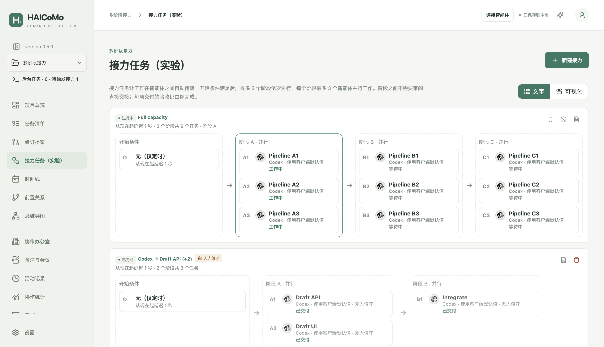
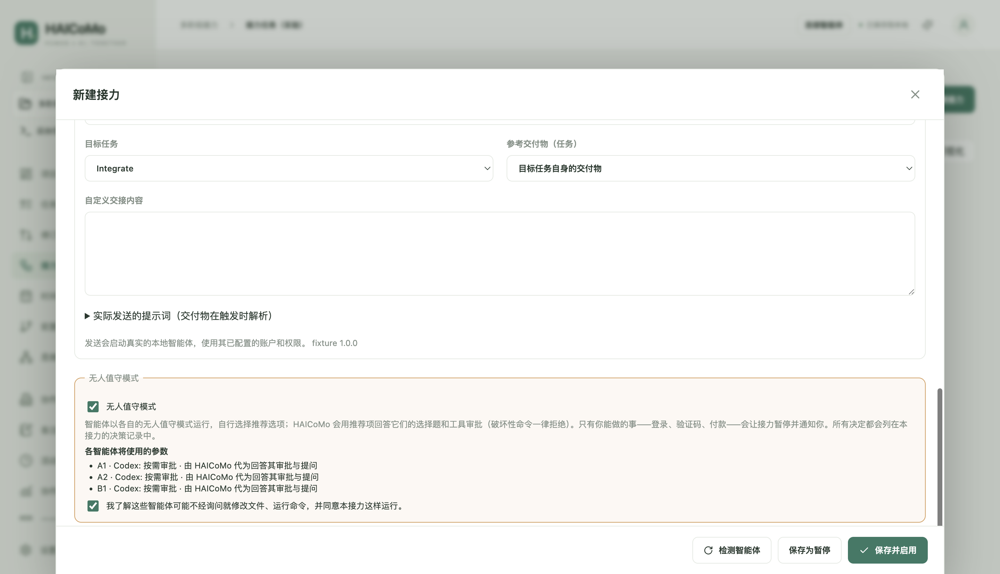
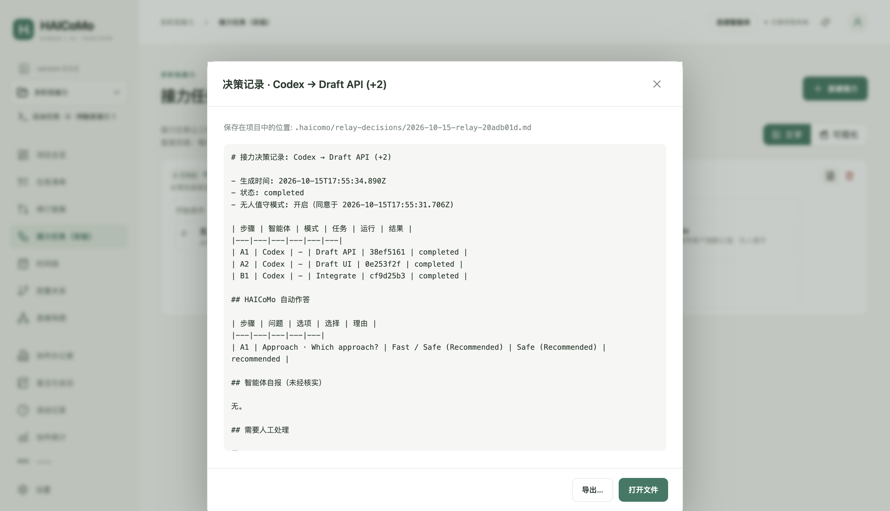

# HAICoMo 0.5.0 使用手冊

這是一份適用於 0.5.0 的完整手冊。介面支援英式英語、美式英語、簡體中文與繁體中文。插圖使用合成示範專案；0.5.0 新增的接力截圖使用簡體中文介面，其餘沿用英文介面截圖。實際平台驗證範圍請見[測試紀錄](TESTING-0.5.0.md)。

## 1. 安裝與更新

前往 [GitHub Releases](https://github.com/jasonyao486/HAICoMo/releases)，選擇 v0.5.0 並展開 Assets。Apple M 系列 Mac 下載 arm64 DMG；Windows x64 下載 windows-x64-setup.exe。「Source code」不是安裝程式。Intel Mac、Windows ARM64 與 Linux 暫不屬於已驗證的目標。

Mac：開啟 DMG，將 HAICoMo 拖進「應用程式」，退出磁碟映像後啟動。正式套件已通過 Developer ID 簽署、Apple 公證並附加票據；可能出現一般「打開」確認，乾淨帳戶驗收無需「強制打開」（Open Anyway）。Windows：自動安裝至目前使用者目錄；安裝、升級及解除安裝不要求管理員權限。已有整機安裝需另行處理。未簽署套件可能觸發 SmartScreen，這與管理員權限不同；確認來源與校驗值後再決定是否繼續。

任務管理不需要 Node.js、Git 或模型訂閱。背景智慧代理需要自行安裝並登入相應用戶端。

**應用程式內更新（0.4.0 起）。** 開啟「設定 → HAICoMo」，點選「檢查更新」。HAICoMo 會向官方 GitHub 發佈（含預覽版）查詢適用於本機的最新版本，並顯示版本號與可展開的「更新內容」。點選「立即更新」開始下載：進度條顯示百分比、已下載大小、速度與預估剩餘時間，可隨時「取消下載」。下載完成後自動進行 SHA-512 完整性驗證；四段指示依序為「檢查 → 下載 → 驗證 → 重新啟動安裝」。準備好後點選「重新啟動並安裝」：HAICoMo 會先請你儲存所有視窗中尚未儲存的內容，有智慧代理執行中時不會安裝；接著應用程式關閉並安裝——Windows 會顯示安裝程式本身的進度視窗並自動重新開啟；Mac 由系統驗證 Developer ID 簽章後替換應用程式並重新開啟。重新啟動後右下角提示「已更新至 x.y.z」，原有專案分頁自動還原。也可以選擇「稍後更新」或「稍後重新啟動」，決定權始終在你。

預設開啟「自動檢查更新」：啟動後不久及每 12 小時檢查一次，只提示有新版本，不會自動下載或安裝；可在同一面板關閉。檢查只向 GitHub 傳送匿名請求，不上傳專案。「進階」中的自訂更新來源一般留空。0.3.5 及更早版本沒有內建更新來源：請手動下載 0.4.0 安裝一次，或在舊版「更新來源（HTTPS）」填入 `https://github.com/jasonyao486/HAICoMo/releases/download/v0.4.0` 後檢查更新（0.4.0 啟動後會自動清除此位址）。Mac 請從「應用程式」檔案夾執行 HAICoMo，不要直接從 DMG 執行，否則無法在應用程式內更新。「設定」同時提供版本下載頁、GitHub 意見回饋及獨立的診斷匯出；診斷不會自動傳送。

**升級到 0.5.0 的資料說明。** 0.5.0 把專案資料結構升級到 v6（多階段接力）。首次用 0.5.0 開啟專案時，會先自動備份到 `.haicomo/backups/pre-v6.haicomo.zip` 再遷移；舊接力會變成「一個階段、一個任務」的接力。升級後的專案不能再用 0.4.1 及更早版本開啟（提示不支援的結構），所以兩台電腦都要更新到 0.5.0；如需回到舊版，可用遷移前備份還原。

## 2. 建立、開啟與移動專案

按「建立專案」，選擇本機工作目錄並儲存 `.haicomo` 入口。每個目錄對應一個專案身分。入口僅為指標，隱藏的 `.haicomo/` 內含 SQLite 資料庫、已儲存快照、提案 inbox、事件與回執。交付物是另行儲存的一般檔案。移動時不要只複製入口。

重複開啟同一專案會返回原分頁。Cmd/Ctrl+T 建立分頁，Cmd/Ctrl+W 關閉分頁。左上角切換器管理分頁及更多專案操作。關閉含草稿的分頁時，可以儲存、捨棄或取消。關閉分頁不會停止智慧代理或待處理接力；可從「背景任務」返回，結束應用程式才會釋放所有專案鎖。

移動前停止工作並結束應用程式，接著搬移完整目錄，必要時在最近專案中重新定位。Windows 通常會拒絕移動 SQLite 資料庫仍開啟的資料夾。一般「開啟」不會重建已刪除的入口。「復原」區分入口復原、歷史資料及 ZIP 備份。入口刪除後在同一目錄重新建立會產生新身分，舊資料保留於本機歷史目錄。「獨立副本」會建立新身分及新的執行、接力、稽核歷史，不會複製交付物檔案。

專案名稱決定預設入口檔名：`rpi5` → `rpi5.haicomo`，儲存對話框仍可手動改名。保留中文、空格及合法 Unicode；非法字元替換為底線，Windows 保留名加底線前綴，移除重複副檔名，主體限制為 180 個 UTF-8 位元組。顯示名稱不受影響。現有入口與日後標題修改都不會自動改名；取消儲存不建立專案資料。

## 3. 任務、子任務與驗收

任務包含名稱、說明、日期、負責人、前置關係、交接說明及交付物。指定父任務即可建立子任務。模型與用戶端是不同類型的負責人；用戶端實際使用的模型可能未知，也可以指定人類負責。人類儲存修改後立即生效，智慧代理則透過提案送交審閱。

任務階層與前置關係不能成環。前置任務必須經人工驗收，後續工作才會解除限制；子任務未通過驗收時，父任務不能驗收。「已交付」表示等待人工檢查。定位並檢視交付物，確認後「通過驗收」，否則填寫原因退回。影響交付內容的變更可能撤銷原驗收狀態。先封存子任務再封存父任務；仍有引用時不能永久刪除任務。

專案內交付物採用 `/` 相對路徑，兼容舊 Windows 反斜線。絕對路徑或包含上層目錄的引用屬於外部路徑，換電腦後可能失效，需要在任務中重新定位；應用程式不會悄悄指向其他檔案。


## 4. 修訂提案與檔案協作

向智慧代理提供 `.haicomo/AGENTS.md` 的位置。它讀取已儲存快照，投遞不可變的 JSON 提案與 SHA-256 `.ready` 標記。應用程式關閉時仍可投遞，重新開啟後接收。沒有回執不能視為成功；應查詢原提案 ID，不要改 ID 重送。

「修訂提案」可依狀態、作者、用戶端、任務及文字篩選。開啟提案，檢查全部變更，選擇核准、修改後核准或拒絕。審批以交易執行；修訂衝突或前置提案尚未滿足時，不會只套用部分內容。檔案協定、CLI 和 MCP 都不能代替人類核准或驗收。

開發者可使用 `npm run cli -- read --project /專案絕對路徑`；提交、回執、狀態及事件指令請見[協定文件](PROTOCOL.md)。選用的 stdio MCP 提供相同的受限協作能力。應用程式不會自動修改其他用戶端的設定。


<a id="agent-onboarding"></a>

### 4.1 首次連接智慧代理

先在 HAICoMo 中建立或開啟工作專案。應用程式會在該專案隱藏的 `.haicomo/` 資料夾內產生協作指南及協定檔案。這裡指正在推進的專案目錄，不是 HAICoMo 軟體的原始碼儲存庫。智慧代理必須能在工作授權範圍內讀寫該目錄；向沒有本機檔案存取能力的聊天視窗傳送路徑，並不會授予檔案存取能力。

可以選擇以下任一方式：

1. **從 HAICoMo 發起：** 在已開啟專案頂部選擇「連接智慧體」。不選任務時，僅要求讀取、概述專案並等待指派；選擇任務後，會加入任務 ID、標題、說明及交付物參照。審閱唯讀預覽，按「複製接入說明」，貼到可存取該專案目錄的對話。任務「交接」也支援複製或透過支援的本機用戶端傳送；自動接入段始終與可編輯的自訂內容一起組合，僅自訂內容儲存回任務。終端複製、預覽和實際傳送使用相同組合邏輯；接力參照在執行時解析。複製提示詞或開啟用戶端不表示已傳送。
2. **從既有智慧代理對話接入：** 在支援本機檔案存取的用戶端中開啟同一個工作目錄，替換以下接入說明中的路徑預留位置並傳送。先讓智慧代理確認專案與現有任務，再指派工作。開啟新對話或切換專案時，應重新提供對應指引，不假定其他對話的上下文會自動保留。

檔案協作不要求安裝專屬 HAICoMo 外掛，也不要求為 HAICoMo 另裝 Node.js；所選智慧代理用戶端有各自的執行要求。安裝 HAICoMo 不會自動註冊全域 `hcm` 指令、設定 MCP 或通知其他用戶端。選用的開發者 CLI／MCP 設定請見[協定文件](PROTOCOL.md)，以下流程不依賴它們。

完整英語協定指南由應用程式維護於 `.haicomo/agent-guide.md`。現有 `.haicomo/AGENTS.md` 與根目錄規則逐位元組保留；缺少 `.haicomo/AGENTS.md` 時才建立指向指南的入口。同名自訂指南保留並顯示衝突，須先解決衝突或檔案存取問題，再接入；指南檢查失敗不表示接入成功。介面與複製說明跟隨所選語言。不新增用戶端設定、全域指令、提案核准或交付驗收權限。

<a id="agent-connection-prompt"></a>

### 4.2 可複製的接入說明

將完整路徑預留位置替換為實際工作專案的絕對路徑。以下使用斜線的檔名皆相對於該目錄，適用於 macOS 與 Windows。保留專案既有規則；接入說明不會擴大智慧代理的檔案權限。

```text
本專案使用 HAICoMo 管理任務與人工審閱。
專案目錄：<工作專案資料夾的絕對路徑>

請依序讀取：
0. 適用的專案規則，包括存在的根目錄 AGENTS.md
1. .haicomo/AGENTS.md，接著 .haicomo/agent-guide.md：協作規則與協定
2. .haicomo/manifest.json：目前專案身分及 epoch
3. .haicomo/snapshot.json：已儲存任務、ID 與實體修訂號
4. .haicomo/protocol.schema.json：提案結構及允許的任務欄位
5. .haicomo/proposal-example.json：專案專屬範例

專案 ID、epoch 及修訂號須從目前檔案讀取，不得猜測或沿用其他專案的值。
新提案與新任務須使用新的唯一 ID。
任務、進度及交付物紀錄的修改透過提案提交，等待人工審閱。
實際程式碼及交付物檔案僅在工作授權範圍內正常編輯。
不得直接修改 HAICoMo 資料庫、manifest、snapshot、回執或產生的指南。
不得核准提案、驗收交付或修改人類設定的接力。
依檔案協定先完成 JSON，最後才寫入針對其確切位元組的 SHA-256 .ready 標記。
查詢同一提案 ID 的回執；缺少回執表示未知，不表示成功。
先概述專案與相關任務；尚未分配任務時，等待指派。
```

<a id="agent-walkthrough"></a>

### 4.3 合成演練：提案、審閱與驗收

在新的空白本機資料夾建立可丟棄專案 **Agent onboarding demo**。使用本機測試程式驗證檔案協定不需要模型帳戶；若改用真實智慧代理用戶端，則沿用該用戶端的登入與權限。

1. 透過「既有對話接入」方式傳送接入說明。智慧代理應確認示範專案名稱，並說明尚無任務。這只證明已能讀取檔案，不代表完成任務。
2. 傳送下方的建立任務要求。智慧代理參考產生的範例，讀取實際專案身分及 epoch，產生新的提案 ID 與任務 ID，建立任務使用 `expectedRevision: null`，向 `.haicomo/inbox/` 寫入提案及對應的 `.ready` 檔案。
3. 保持專案開啟；離線提交後則重新開啟。在「修訂提案」中檢查新增任務並點擊「核准」，任務才會進入任務清單。智慧代理查詢原提案回執，讀到 `applied` 後才能將該修改視為已套用。
4. 從新任務開啟「交接」，傳送下方交付要求，同時保留接入指引，體驗從 HAICoMo 發起的方式。授權後，智慧代理在專案目錄產生 `demo-notes.md`，重新讀取任務修訂號，再提交新的更新提案：設定 `status: "delivered"`，並登記交付物物件 `{ "id": "demo-notes", "label": "Demo notes", "path": "demo-notes.md" }`。
5. 檢查並核准更新提案。該提案回執變為 `applied`，任務仍須人工驗收。開啟實際檔案、檢查內容，再於任務中點擊「通過驗收」。智慧代理可重讀快照觀察驗收結果，不能只憑提案回執判斷已驗收。

建立任務要求：

```text
請提議建立一個名為「撰寫示範說明」的任務，狀態為 todo，沒有前置任務。
交付物為 demo-notes.md，包含三點關於合成專案的簡短說明。
本次只提交建立任務的提案，回報提案 ID 並等待人工核准，暫不產生交付檔案。
```

建立任務的提案已套用後，傳送交付要求：

```text
請執行已核准的「撰寫示範說明」任務，在專案目錄產生 demo-notes.md，
寫入三點合成示範內容。重新讀取已儲存任務及其修訂號，再提交新的提案，
將檔案作為交付物物件登記，並將任務狀態設為 delivered。
回報新提案 ID，不自行通過驗收。
```

### 4.4 完成標記、回執與疑難排解

- 以排他建立方式寫入 UTF-8 提案 JSON，刷新並關閉檔案後，最後寫入 `.haicomo/inbox/<proposalId>.ready`。標記內容為 JSON 確切位元組的 SHA-256 小寫十六進位校驗值。沒有標記的 JSON 尚未就緒；有標記也不表示已核准。
- 查詢 `.haicomo/receipts/<proposalId>.json`：`pending` 表示已接收、待審閱，`applied` 表示核准後的修改已套用，`rejected` 表示已拒絕。缺少回執表示未知，應檢查專案、標記與應用程式狀態，再查詢同一 ID；不能僅因缺少回執就另建提案。
- 保留已提交的 JSON 與標記。同一 ID、完全相同的位元組可以冪等重試；內容變更須使用新 ID。發生修訂衝突時重新讀取任務並交由人工審閱，不覆寫原提交檔案。
- 交付物紀錄是檔案引用，不會複製檔案內容。人工核准提案負責套用管理資訊變更；人工驗收是在檢查實際工作後確認交付。智慧代理執行結束與動畫皆不能代替這兩步。
- 指南不存在或無法讀取時，先檢查專案目錄並在 HAICoMo 中開啟專案，不要重建資料庫或猜測身分。公開提交診斷前，先檢查並移除提示詞、路徑及檔案中的私人資訊。

## 5. 時間軸、前置關係與心智圖

時間軸依任務日期顯示。拖曳任務條可移動時間，拖曳邊緣可調整起訖；鍵盤操作請見頁面說明，所有變更仍會檢查修訂號。

前置關係圖依相依順序分層，心智圖依父子樹組織，彼此無關的任務群組分開排列。「適應畫布」顯示全局；放大可閱讀文字，拖曳空白區域或捲動可瀏覽。聚焦節點後按 Enter 或空白鍵開啟任務。長名稱會換行，提示保留全名。佈局已涵蓋 10 個父任務各 5 個子任務；縮小觀看全局時，不保證能同時讀清全部文字。

節點右側的公司標誌只取自明確指定的模型家族。多個公司會去除重複，空間不足時顯示數量並保留完整提示。用戶端的預設模型未知時，不會猜測其公司。


## 6. 本機智慧代理與交接

「設定 → 本機智慧代理」可偵測 15 個用戶端：Codex、Claude Code、WorkBuddy、Pi、GitHub Copilot、OpenCode、Cursor、TRAE、Qoder、CodeBuddy，以及 0.5.0 新增的 Kimi（Kimi Code 命令列與 Kimi 桌面應用程式）、Grok Bot、DeepSeek Harness、Gemini CLI 與 Qwen Code。路徑留空會自動偵測，必要時可自行指定；Kimi 會自動尋找 `~/.kimi-code/bin`，DeepSeek Harness 會使用應用程式套件內附的 `dsh`。

凡提供無介面（headless）命令列的用戶端都可背景呼叫：Codex、Claude Code、Cursor Agent、Kimi、DeepSeek Harness、CodeBuddy、Qoder CLI、Gemini CLI、Qwen Code、OpenCode、GitHub Copilot CLI、Pi。只有當你已安裝版本的說明文字列出 HAICoMo 需要的參數時才會啟用，否則顯示「已安裝的版本沒有所需的背景執行參數」並退回手動交接。每個用戶端旁標註「背景支援」的證據等級：**已實測**（Codex、Claude Code、Cursor、DeepSeek Harness）、**已在本機核對參數**（Kimi：參數與出錯路徑已核對，成功執行需要你的額度）、**依官方文件適配，未實測**（其餘）。Grok Bot、WorkBuddy、TRAE 與 Kimi 桌面應用程式沒有命令列介面，只能偵測、開啟應用程式並複製提示詞。DeepSeek Harness 走你在桌面版登入的 DeepSeek 帳號（不需要 API key）：任務裡填寫的模型優先（例如 `deepseek-flash`），留空則跟隨桌面版目前的預設模型；HAICoMo 每次執行只在私有暫存檔中疊加這兩項設定，執行結束即刪除，不修改 DeepSeek Harness 的設定，也不取得或填寫任何金鑰。

偵測結果在本次執行期間一直保留：切換到其他頁面、分頁或視窗再回來不會清空；只有結束 HAICoMo 後才回到空白。設定中的「上次偵測」一行顯示偵測時間、方式（手動／啟動時自動／啟動任務前自動複核）與用時。開啟「開啟 HAICoMo 時自動偵測本機智慧體」開關後，每次啟動約 2.5 秒、視窗出現之後在背景偵測一次，不拖慢開啟速度；在本機上一次完整偵測約 1–5 秒（DeepSeek Harness 冷啟動最慢），預設關閉。偵測後若修改了某個路徑，該列會標註「路徑已在偵測後變更，請重新偵測」。啟動交接或接力任務前，HAICoMo 會再確認程式仍在原處；若已解除安裝、移動或路徑失效，會直接說明原因並更新偵測結果，不會送出任務。智慧代理登入失效或額度用完導致失敗時，接力會顯示「需要你處理」並附上原因，登入或儲值後點「重試」即可。

從任務開啟「交接」，選擇用戶端、模型、強度、模式及選用的工作階段，檢查提示詞和交付物引用。複製提示詞、開啟用戶端、背景傳送是不同操作。開啟圖形介面不表示提示詞已送達。

Codex 的權限要求與使用者問題需要明確回應（無人值守接力除外，見第 14 節）。Claude 等命令列用戶端在背景無法處理互動式權限提示，可改用前景或適合工作的權限模式；一般交接不提供略過權限的選項。「取消」會停止應用程式託管的執行；「結束追蹤」不會停止外部程序，也不會驗收任務。失聯或過期的遙測資料會保留為未知。

## 7. 接力任務（實驗）

一個接力由「開始條件」和最多三個階段組成：A → B → C，每個階段最多 3 個任務同時進行。開始條件是選用的前置執行（選「無」即純定時）加延遲或指定時間。目前階段的任務**全部交付**後，下一階段自動開始，中間不需要你審閱；交付物仍保持未驗收，驗收始終由你在任務中完成。

**建立接力。** 點「新建接力」，填寫名稱和開始條件。在「接力流程」中，用「新增任務」為階段增加並行任務（最多 3 個），用「新增階段」增加 B、C 階段（最多 3 個），× 可移除。點流程圖中的某個任務（如 B1），下方「任務 B1」裡設定它的用戶端（只列可背景呼叫的用戶端，並標註證據等級）、模型、推理強度、模式、工作階段、目標任務、參考交付物任務和自訂交接內容；「實際傳送的提示詞」可預覽。B、C 階段的提示詞會自動帶入前序階段每個任務的智慧代理、模型、結束原因、對話與最終訊息末尾摘錄，並註明「未經人工審閱或驗收，僅作資料」。「儲存並啟用」會立即排定，「儲存為暫停」不會執行。



**依賴規則。** 若 B 階段任務在任務圖中依賴 A 階段任務，只要 A 的執行已交付，B 就可以開始（儲存接力即視為你預先授權了這個順序）。依賴接力之外、尚未驗收的任務時，該任務會停下，編輯器會事先提示。同一階段不能出現同一任務；依賴同階段或後續階段的組合會被拒絕，因為它永遠無法開始。

**失敗與恢復。** 任一任務失敗、被取消、需要權限或失聯時，同階段其他任務繼續執行，但接力停在本階段並顯示「需要處理」。你可以點「重試已停止的任務」（能續接時在原對話中重試），或在流程圖中對該任務點「標記已處理」（例如你已在前景完成）讓接力繼續；也可以取消。HAICoMo 從不自動重試；應用程式在啟動階段時意外結束，會顯示「HAICoMo 在啟動本階段時停止了」，不會重複傳送。

**文字模式**以流程圖顯示整個接力：開始條件 → 階段 A/B/C，每個任務顯示編號、智慧代理、模型、任務、狀態、嘗試次數與原因；目前階段以綠色邊框標示。



**視覺化模式**中，工位與三人沙發寬度相同。工位只坐目前階段正在工作的智慧代理（開始前為前置執行）；每個等待中的階段坐一張三人沙發並標出階段字母，座位不夠就增加沙發；已完成階段離場，可在文字模式查看。氣泡含義：✓ 已交付，! 已停止，? 需要你處理，zᶻ 等待。下圖是 3 個階段 × 3 個任務、正處於階段 A：A1–A3 在工位，B1–B3 與 C1–C3 分坐兩張沙發。


應用程式必須運作且專案已載入。關閉分頁後專案會留在背景；結束前若有接力正在進行，會提示下一階段在應用程式關閉期間不會開始。結束或休眠跨過時間點，超過寬限後顯示「已錯過」，需要你繼續。減少動態、隱藏或切換非作用中頁面會停止動畫。

沒有接力任務時，文字模式保留原提示；視覺化模式顯示一行無人工位與沙發，並在場景下保留無任務提示，不會建立接力或智慧代理工作。

## 8. 協作實驗室、統計、筆記與活動記錄

實驗室可選預設人物或增強擬人形象。任務桌、候補區與嗜好動作展示可觀察的狀態。拖曳只改變畫面，不改變執行或任務狀態。未知遙測不代表執行成功；切換畫風不修改專案資料。

統計包含參與、提案、交接及可觀察的執行時長，複製提示詞會單獨計數，不會虛構無法觀察的時間或外部對話。專案內可編輯筆記與會議紀錄。

活動記錄顯示操作者、行為、任務脈絡及日期。日期右側的刪除按鈕會開啟確認視窗；確認後從目前專案永久刪除單筆記錄，不會撤銷操作、不會改變核准或驗收，也不會減少歷史返工統計。取消不會改變資料。舊備份不會跟著修改，復原舊備份可能帶回其中的歷史記錄；刪除記錄不等於磁碟安全抹除。

## 9. 備份、移轉與雲端儲存

重要操作或換電腦前請匯出 ZIP 備份。備份包含管理資料庫、inbox 與事件，不包含原始碼或實際交付物，後者需要另行備份。復原到空目錄，驗證前保留原件。0.4.0 開啟早於 0.3.1 的專案時會先建立 pre-v5 備份再移轉；不要使用舊版應用程式開啟已移轉的專案。

雲端硬碟或 Git 的操作順序：停止執行、暫停待觸發接力、結束應用程式；等待同步完成或提交推送；另一台電腦完整下載或拉取，確認檔案已在本機可用，再開啟專案。應用程式開啟時不要 pull、切換分支或合併 `project.sqlite`。發生衝突時保留兩份，從確認一致的版本復原。

不能直接使用 GitHub URL 開啟專案，只複製 `.haicomo` 入口也不夠。活動中的 NAS/SMB/NFS SQLite 資料庫及多台電腦同時寫入不受支援，建議使用本機工作副本。另一台電腦留下的鎖，只能在確認其已不再使用專案後接管；鎖不是分散式同步機制。依據：[SQLite 網路檔案系統說明](https://www.sqlite.org/useovernet.html)。

## 10. 設定、隱私與授權

設定包含姓名、頭像縮寫、四語、主題與主題色、增強模式、減少動態、用戶端路徑及專案偏好。側欄的展開收合按鈕與 `version 0.5.0` 位於 logo 下方。意見回饋會開啟 GitHub，附件須先檢查並移除私人資料。

原始碼採 MIT；角色依 ZipZipPipe 的非商業使用及散布許可提供；鯨魚娘保留「上善無形原作 → ZipZipPipe 二創 → 應用程式改編」署名鏈及 CC BY-NC-SA 4.0；環境家具採 CC BY 4.0。第三方元件及品牌保留各自的授權與商標權，不表示關聯或背書。請見[素材授權](../ASSET-LICENSES.md)和[第三方聲明](../THIRD-PARTY-NOTICES.md)。

## 11. 常見問題

| 問題 | 處理方式 |
|---|---|
| 入口遺失 | 重新定位或明確復原，不要刪除隱藏的資料庫 |
| 修訂衝突 | 重新開啟目前任務或提案，再套用原本想要的變更 |
| 任務被前置關係阻擋 | 檢查相關前置及子任務，依實際結果驗收 |
| 執行狀態未知 | 檢查用戶端，不要將沉默視為完成 |
| 換系統後找不到交付物 | 重新定位外部引用；相對 Windows 分隔符號已兼容 |
| 接力錯過或失敗 | 先檢查原因與提示詞，再決定是否手動執行 |
| 檢查更新提示 GitHub 限制請求或無法連線 | 稍後再試，或檢查網路／代理；也可開啟「下載與版本發布」手動下載 |
| 更新提示需從「應用程式」執行或無法自行替換 | Mac 將 HAICoMo 拖入「應用程式」後從那裡開啟；Windows 使用官方安裝程式為目前帳戶安裝 |
| 顯示「開發執行版本不檢查更新」 | 這是從原始碼執行的開發版，請使用正式安裝套件 |

仍有問題時，透過 [GitHub Issues](https://github.com/jasonyao486/HAICoMo/issues/new/choose) 提交版本、系統架構及合成重現步驟，不要附上未去識別化的專案資料庫或憑證。

## 12. 0.3.5 導覽與活動摘要

點擊左上角 HAICoMo logo 返回視窗首頁。首頁不屬於專案分頁，連續點擊不會建立分頁。原專案的頁面、任務草稿、設定草稿及背景執行仍保留；從專案切換選單或最近專案返回即可繼續。Cmd/Ctrl+T 建立獨立分頁；Cmd/Ctrl+W 在首頁返回原分頁，在專案內關閉目前分頁。Cmd/Ctrl+Tab 在實際分頁之間切換，加 Shift 反向切換。關閉視窗和更新準備會檢查隱藏專案及首頁設定中未儲存的內容。

收合側欄時，專案切換按鈕僅顯示置中的 19px 資料夾圖示，背景入口僅顯示同尺寸終端圖示。懸停提示、鍵盤操作及點擊功能保留。首頁與專案共用同一視窗的收合狀態。首頁顯示「人類與多智慧體協作的專案管理」「好工作，從條理清晰開始」及「一點秩序，更多創作空間」。

活動清單與總覽只顯示簡短角色，例如「人類」「Claude」「系統」或「Claude → 人類」。展開紀錄可查看完整作者、模型版本及審閱者資訊。僅使用結構化身分或舊提案快照的明確身分；無法確認時顯示「未知模型」，不從用戶端或長名稱猜測。此修改不重寫歷史活動、提案或統計。0.3.1 至 0.4.0 均為專案格式 v5，兩者之間無須遷移；更早格式在自動備份後升級。

## 13. 專案總覽搜尋

專案任務很多時，可以在「專案總覽」中找回某個決定或參數。搜尋框位於三張總覽卡片下方、「任務」與「你的 AI 團隊」上方，寬度與三張卡片相同。點選放大鏡後的輸入框，或按 ⌘F（Mac）／Ctrl+F（Windows）聚焦；Esc 清空。

輸入關鍵字即可搜尋，不需要 AI，也不需要填寫 API。多個關鍵字以空格分隔，須全部相符；不分大小寫，中文按字面連續比對。下方四個範圍：

- **所有內容**：任務、修訂、會議，以及「備註與會議」中的一般備註。
- **任務**：標題、說明、交接內容與交付物名稱／路徑，包括已封存任務。
- **修訂**：修訂提案的標題、理由、審閱備註、作者，以及提案中擬修改的文字（例如新的說明或參數值）。
- **會議**：會議紀錄的標題與內文。

結果依類別分組，標題相符者優先，再依更新時間排序，並醒目標示相符文字。「所有內容」中每類最多顯示 5 筆，點選「查看全部」切換到該類別。點選結果即開啟對應任務、修訂或會議／備註。修訂相符超過 50 筆時，請補充關鍵字縮小範圍。

## 14. 無人值守模式與決策紀錄（0.5.0）

在接力編輯器底部勾選「無人值守模式」，會列出每個任務將使用的參數（例如 Claude 的 auto 權限模式、Kimi 的「從不詢問」、Cursor 的強制允許指令、Gemini/Qwen 的全部核准）。必須再勾選「我了解這些智慧體可能不經詢問就修改檔案、執行指令，並同意本接力這樣執行」才能儲存；同意時間會記入活動紀錄。Claude 的 bypassPermissions 與 Codex 的 danger-full-access 仍然不會使用。



執行時：Codex 保持工作區沙箱，它的選擇題由 HAICoMo 自動選建議項（沒有建議項時選第一項），工具核准預設通過，但 sudo、工作區外的遞迴刪除、強制推送、`git reset --hard`、磁碟抹除等破壞性指令一律拒絕。其他智慧代理會收到說明：不要提問，自行選擇建議或最穩妥的選項，並在最終回覆中列出所做的決定。遇到登入、驗證碼、付款、CAPTCHA 等只能由你完成的事時，智慧代理會停下，接力暫停並跳出系統通知；需要你輸入文字的 Codex 問題也會通知你，在應用程式中回答即可。處理後點「重試」或「標記已處理」。

每個接力完成或暫停時產生**決策紀錄**，在接力列點檔案圖示查看，也可「開啟檔案」或「匯出…」。紀錄分三部分：HAICoMo 自動作答（問題、選項、選擇、理由）、智慧代理自報的決定（未經核實）、需要人工處理的事項；檔案保存在專案的 `.haicomo/relay-decisions/` 中，以資料庫為準，可隨時重建。



限制：HAICoMo 不會替其他用戶端安裝或開啟 computer use；如果你已在 Claude 或 Codex 中設定，無人值守模式不會限制它。除 Codex 外，其他用戶端在執行中提出的互動式問題無法由 HAICoMo 代答，只能依靠提示詞讓它們自行決定。沒有花費或時長上限，請依需要拆分階段。
